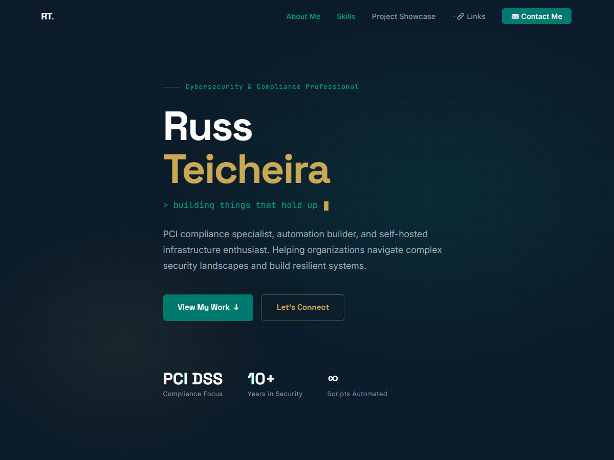

# Cybersecurity & Compliance Portfolio WordPress Theme

>[!IMPORTANT]
> To be completely transparent up front: this theme was *developed with the assistance of Claude*. If AI-generated code isn't your thing, this might not be the project for you.
>
> While I highly respect and support developers who write everything from scratch, I had a highly specific vision in mind for this theme that I couldn't find anywhere else. Additionally, I wanted a hands-on project to level up my AI-assisted workflows, something that is increasingly relevant for my professional work. While I use AI for my daily analytics and scripting on the job, I hadn't yet built a project of this scale completely from the ground up.
>
> Over the last week, I've poured countless hours into this theme—tweaking components and constantly steering Claude to get it to do exactly what I wanted (Skynet isn't taking over just yet, trust me). Interestingly, for a tool designed to maximize efficiency, it introduced a massive amount of technical debt; I spent a day and a half solely troubleshooting and squashing bugs.
>
> Thank you for checking it out! If you decide to use it, I'd love to hear your feedback. **Please note that I do not currently plan to publish this to the official WordPress repository**. If you find this there, it wasn't published by me.
>
> ~Russ

[](https://github.com/rteicheira/wp-cs-theme/actions/workflows/github-code-scanning/codeql) [](https://github.com/rteicheira/wp-cs-theme/actions/workflows/phpmd.yml)

This is a custom WordPress theme for [russteicheira.net](https://russteicheira.net). While I designed this for my own use, I did try to add enough flexibility for others to use it as well.

The theme is built for a cybersecurity and compliance professional. The theme combines a personal blog with a structured portfolio using three custom post types for: Projects, Expertise, and Certifications, with a shared Skill taxonomy that links related content across the entire site.

The homepage is assembled from independently controlled sections, each with configurable visibility, color schemes, and background images managed through a dedicated admin page.

> [!important]
> **Minimum Requirements:**   
>
> **Recommended Requirements:**   



## Structure

```text
wp-cs-theme/
├── style.css                  ← Required WP theme header
├── screenshot.png             ← WP admin theme thumbnail (1200×900)
├── functions.php              ← Setup, enqueue, CPTs, taxonomies, AJAX, helpers
├── theme.json                 ← Block editor color/font palette
├── front-page.php             ← Homepage (all sections)
├── index.php                  ← Blog archive / fallback archive
├── single.php                 ← Single blog post
├── single-project.php         ← Single project page
├── page.php                   ← Static page template
├── archive-project.php        ← Project archive
├── taxonomy-skill.php         ← Skill taxonomy archive (posts + projects)
├── search.php                 ← Search results page
├── comments.php               ← Comment thread + webmention display
├── 404.php                    ← Not found
├── header.php                 ← <head>, nav, search overlay
├── footer.php                 ← footer, wp_footer()
├── css/
│   ├── main.css               ← All styles (tokens → responsive)
│   ├── admin-sections.css     ← Sections admin page styles
│   ├── prism.css              ← Prism syntax highlighting styles
│   ├── fonts.css              ← @font-face declarations
│   └── fonts/                 ← Self-hosted woff2 files
│       ├── inter-v20-latin.woff2
│       ├── jetbrains-mono-v24-latin.woff2
│       └── space-grotesk-v22-latin.woff2
├── js/
│   ├── main.js                ← Nav, search overlay, typewriter, smooth scroll, contact AJAX
│   ├── spam-protection.js     ← Turnstile / reCAPTCHA token handling for contact, comment + login forms
│   ├── prism.js               ← Prism syntax highlighting library (vendor)
│   ├── admin-sections.js      ← Sections admin page: color picker, media uploader, tab nav
│   ├── admin-sections-skills.js ← Sections admin page: About section skills tag widget
│   ├── admin-field-counters.js ← Capability/expertise title+excerpt character counters
│   ├── admin-code-lang.js     ← Gutenberg sidebar: code block language selector
│   └── customizer-preview.js  ← Customizer live preview bindings
├── preview/
│   ├── static.html            ← Full static preview of the homepage
│   ├── screenshot.png         ← Source image for the WP admin thumbnail
│   └── portrait.jpg           ← Placeholder showing portrait position in About section
├── template-parts/
│   ├── hero.php               ← Hero / above-the-fold section
│   ├── about.php              ← About Me + capabilities panel
│   ├── expertise.php          ← Core Expertise cards
│   ├── projects.php           ← Portfolio preview (featured Projects CPT)
│   ├── blog-preview.php       ← Latest posts preview
│   ├── certs.php              ← Certifications section
│   └── contact.php            ← AJAX contact form
├── inc/
    ├── webmention.php         ← IndieWeb Webmention send/receive support
    ├── section-settings.php   ← Sections admin page (visibility, colors, bg images)
    ├── customizer.php         ← Customizer panels, settings, controls
    ├── series-manager.php     ← Series Manager admin page (drag-to-reorder posts in a series)
    ├── spam-protection.php    ← Settings → Spam Protection (Cloudflare Turnstile / Google reCAPTCHA)
    ├── hardening.php          ← XML-RPC off, usernames kept private
    └── fallback-nav.php       ← Hardcoded nav if no WP menu assigned
```

## Custom Post Types

### Projects

Each project supports:

- **Title** — project name
- **Excerpt** — card description (keep under 40 words)
- **Skills** (taxonomy) — gold skill badges linking to skill archives (Docker, PowerShell, etc.)
- **Tags** — teal keyword tags shown at the bottom of the single project page
- **Featured thumbnail** — optional
- **Live URL** — meta field; shown as "↗ Live Site" link on cards and in single page meta
- **GitHub URL** — meta field; shown as "🐙 GitHub" link on cards and in single page meta
- **Featured** — controls visibility on the homepage projects section

Project cards link to the WordPress project page. Live Site and GitHub links appear as a separate row at the bottom of each card.

### Capabilities

Displayed in the capabilities panel on the right side of the About section. Maximum of 5 items enforced.

- **Title** — capability name
- **Excerpt** — short description shown below the title
- **Icon** — emoji displayed alongside the title (meta field)

### Expertise

Displayed as cards in the Core Expertise section.

- **Title** — expertise area name
- **Excerpt** — card description
- **Icon** — emoji displayed on the card (meta field)
- **Skills** (taxonomy) — shared with Projects and blog posts; skill tags link to skill archives

### Certifications

Displayed in the Certifications section. Admin-only — no public archive or single post URL.

- **Title** — certification name
- **Excerpt** — issuing body or short description
- **Issue Date** — shown on the card
- **Expiry Date** — shown on the card; leave blank for non-expiring certs
- **Credential ID** — badge/certificate ID number; leave blank to hide
- **Credential URL** — links the cert card to a verification page
- **Order** — controls display order via page-attributes

## Taxonomies

### Series

A taxonomy registered on **Posts** only, used to group related posts into a numbered series.

- On single posts the **Series Navigation** block shows the full list of posts in the series, with the current post highlighted and its "Part X of Y" position in the header
- Reading order defaults to publish date ASC; administrators can drag-and-drop a custom order at **WP Admin → Posts → Manage Series**
- Custom order is stored as `_rt_series_order` term meta (array of post IDs); posts added since the last save are automatically appended at the end
- The shared helper `rt_apply_series_order( array $ids, $term_id )` in `functions.php` handles the ordering logic for both the public series nav and the admin manager page

### Skill

A shared taxonomy registered on **Posts**, **Projects**, and **Expertise**.

- Tags display in gold (`card-tag`) everywhere and link to `/skill/<slug>/`
- The skill archive (`taxonomy-skill.php`) lists both blog posts and projects in a unified view
- Skill tags appear under the post/project title on single pages

## Sections Admin Page

**WP Admin → Sections** controls per-section visibility, colors, and background images. Saving this page automatically clears Jetpack Boost and W3 Total Cache page caches.

The **About** section has additional content fields:

| Field | Notes |
| --- | --- |
| Body | Rich-text editor for the About Me body copy |
| Skills | Tag-style picker; selected skills appear as gold badges below the body |
| Portrait Photo | Optional circular photo displayed above the eyebrow label; leave blank to hide |

The **Blog** section has additional card meta toggles:

| Toggle | Controls |
| --- | --- |
| Post date | Date shown on blog cards |
| Author | Author name shown on blog cards |
| Category | Primary category shown on blog cards |
| Skills | Skill tag row shown on blog cards |

## Footer Settings

Footer content is configurable in **Appearance → Customize → Footer**:

| Field | Default | Notes |
| --- | --- | --- |
| Site Tagline | `Cybersecurity & Compliance Professional` | Shown under the logo |
| Copyright Name | Site title | Name shown in the copyright line |
| Credit Line | *(blank)* | Optional "Built by …" line |
| Document Links | *(blank)* | HTML links rendered above the copyright bar |

Social/contact icons in the footer are pulled from the **Contact** section link list.

## Contact Form

Submits via WordPress AJAX to `wp_mail()`. No plugin required.
Destination email = WP admin email (`Settings → General → Administration Email Address`).

## Spam Protection

`Settings → Spam Protection` adds a bot check to *Comment boxes* (logged-out visitors only; webmentions are unaffected), *Contact forms*, and *Log in, password reset, and registration* (`wp-login.php`). Each can be ticked on or off. Off until enabled with keys for the chosen provider:

- **Cloudflare Turnstile** (default) — rendered with `appearance: interaction-only`, so it's invisible unless Cloudflare wants a click. Use the *Managed* widget mode.
- **Google reCAPTCHA** — v3 (invisible, score threshold 0.1–0.9) or v2 checkbox.

Each provider keeps its own keys, so switching doesn't lose them. Secret keys are never echoed back to the admin screen.

The provider script loads only on pages with a protected form, on first focus of the form (reCAPTCHA v2: when the form nears the viewport). Outcomes:

| Result | Contact form | Comment |
|--------|--------------|---------|
| Verified | Sent | Normal moderation rules |
| Rejected (bad/expired/reused token, low v3 score, wrong host or form) | Error message | `wp_die()` with a back link |
| Unverified (no token because the script was blocked, or provider unreachable) | Sent, subject prefixed `[Unverified]` | Held for moderation |

**Login is stricter** (log in, password reset, registration on `wp-login.php`):

- A request without a completed check is refused, so bots can't skip it by leaving the token out.
- A rejected token is refused.
- Only an unreachable provider lets a login through, so an outage can't lock you out.
- Application-password logins aren't checked. XML-RPC is switched off entirely (see *Hardening* below), so it can't be used to get around the check.
- Sites that saved their settings before login protection existed keep it unticked until it's switched on.
- **Test first:** after saving, open the login page in a private window and make sure you can still log in.
- **Locked out?** Add `define( 'RT_SPAM_PROTECTION_OFF', true );` to `wp-config.php`, log in, fix the settings, then remove the line. While it's set, the settings page shows a warning that protection is switched off.

**CSP:** the theme's own header adds the active provider's origins automatically (front-end pages only; `wp-login.php` doesn't get the theme's header), but the live header is set by the host (see below). Add them there or in the Cloudflare Transform Rule too, and make sure the rule also covers `/wp-login.php` if login protection is on:

- Turnstile: `script-src https://challenges.cloudflare.com; frame-src https://challenges.cloudflare.com`
- reCAPTCHA: `script-src https://www.google.com https://www.gstatic.com; frame-src https://www.google.com https://recaptcha.google.com`

## Hardening

`inc/hardening.php`:

- **XML-RPC is off.** `xmlrpc.php` answers with 403 and no methods are available, so bots can't use it to guess passwords around the login check. The block editor and webmentions use the REST API and keep working. Incoming **pingbacks** stop, because they arrive over XML-RPC; outgoing pingbacks still work. Anything else that needs XML-RPC (e.g. Jetpack or the WordPress mobile app) stops working until this is removed.
- **Your username stays private:**
  - the REST user list (`/wp-json/wp/v2/users`) is only available when logged in
  - `?author=1` and `/author/…` pages return 404
  - oEmbed data has no author
  - there's no users sitemap
  - the login page says "username, email address, or password is incorrect" without saying which

  Posts still show the author's display name. If it's set to the login username, change *Display name publicly as* under Users → Profile.

## Site Logo

The nav and footer display a text logo derived from the first letter of each of the first two words in **Settings → General → Site Title** (e.g. "Russ Teicheira" → `RT.`). If a site icon image is set in the Customizer, that image is used instead.

## Single Post Layout

When a post belongs to a series and/or has two or more H2/H3 headings, `single.php` renders a two-column layout:

| Column | Content |
| --- | --- |
| Left (main) | Post header, featured image, post body, tags, related posts, post navigation, comments |
| Right (sidebar, sticky on desktop) | Series Navigation (if post is in a series), Table of Contents (if ≥ 2 H2/H3 headings) |

On screens ≤ 900px the layout collapses to a single column: the sidebar (TOC and series nav) stacks above the post body. On single-post pages without a series or headings, no sidebar is rendered and the full-width layout is used.

The **Table of Contents** is generated server-side from the post's H2 and H3 tags. H3 items are nested beneath their parent H2 with a `—` prefix. The TOC is omitted entirely if fewer than two headings are found.

The **back-to-top button** (`.back-to-top`) appears at bottom-right after the user scrolls 400px and returns to the top on click. On mobile (≤ 640px) it is anchored to the visual-viewport right edge using `left: calc(100dvw - width - gap)` rather than `right`, ensuring it stays on screen even when the layout viewport is wider than the visual viewport.

A floating **reading time** indicator appears at top-right on screens wider than 960px. On mobile, reading time collapses to inline text in the post header.

## Responsive Breakpoints

| Breakpoint | Behavior |
| --- | --- |
| > 1024px | Full desktop layout |
| ≤ 1024px | Expertise grid → 2 col, footer adjusts |
| ≤ 900px | About/Contact stack to 1 col, blog sidebar hides |
| ≤ 901px | Single post switches from two-column (body + sidebar) to stacked |
| ≤ 768px | Hamburger nav activates |
| ≤ 640px | All grids → 1 col; back-to-top button anchored to visual viewport |

## Cloudflare / Hosting Notes

### CSP is managed by the host, not the theme

The `rt_send_security_headers()` function in `functions.php` sets a `Content-Security-Policy` header, but on this particular hosting setup (Nexcess / NewFold Digital platform) the platform completely replaces that header before the response reaches the client. The live CSP is controlled by the platform and includes additional directives for Termly (cookie consent) and Cloudflare Insights.

This means:

- Changes to the CSP in PHP have no effect on the live site
- To enforce a stricter CSP, create a **Cloudflare Transform Rule** (Rules → Transform Rules → Modify Response Header) that overwrites the `Content-Security-Policy` header at the edge
- The `X-Frame-Options`, `X-Content-Type-Options`, `Referrer-Policy`, and `Permissions-Policy` headers set by the theme *are* passed through as-is

### Cloudflare IP ranges in `functions.php`

`rt_get_visitor_ip()` (used for contact-form rate limiting) validates whether `REMOTE_ADDR` belongs to Cloudflare before trusting the `CF-Connecting-IP` header. The Cloudflare IPv4 and IPv6 CIDR ranges are hardcoded in a static array inside that function.

**These ranges change occasionally.** If rate limiting stops working correctly (all submissions appearing to come from one IP), the ranges may be stale. Verify the current list at:

- <https://www.cloudflare.com/ips-v4>
- <https://www.cloudflare.com/ips-v6>

Update the `$cf_cidrs` array in `functions.php` accordingly.

---

## Limitations

There are a few known limitations:

1. The title structure is geared around one first name and one last name. Additional names should work just fine, but it might look off.
2. I did not program anything around WooCommerce.
3. Currently no way to easily change color overlays (like the grid in the hero section).
4. I am sure I am missing others that I can't think of.
